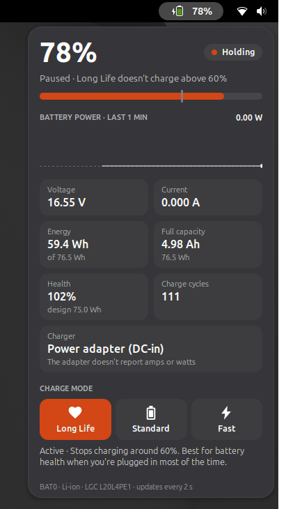
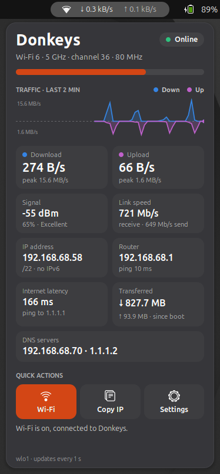

# GNOME Top Bar Widgets

Small GNOME Shell widgets for the top bar. Each one shows a live reading in the bar and opens a detailed popup, all in the same style.

| Widget | In the top bar | In the popup |
|---|---|---|
| [Battery Charge](docs/battery-charge.md) | Battery level and charge rate | Battery and charger readings, power graph, charge mode switch (Long Life, Standard, Fast) |
| [Network Monitor](docs/network-monitor.md) | Download and upload speed | Connection status, signal, traffic graph, IP and router details, latency, quick actions |

<p>
  
  
</p>

Each widget is its own GNOME extension, so you can install one or both.

## Requirements

- GNOME Shell 48, 49 or 50.
- See each widget's page for what it needs from your hardware.

Developed and tested on Ubuntu 26.04 (GNOME 50, Wayland) with a Lenovo IdeaPad 5 Pro 16ACH6.

## Install

```bash
git clone https://github.com/donkeysbe/gnome-top-bar-widgets.git
cd gnome-top-bar-widgets
./install.sh
```

That installs every widget. To install only some of them, name them:

```bash
./install.sh network
```

```bash
./install.sh battery network
```

Then log out and back in: GNOME on Wayland only loads new extensions at login.

The installer copies each widget to `~/.local/share/gnome-shell/extensions/` and turns it on. Battery Charge also installs a udev rule so you can switch charge modes without a password; that step asks for your password ([details](docs/battery-charge.md#switching-modes-without-a-password)).

## Updating

Pull the latest version, run `./install.sh` again, then log out and back in.

## Turning a widget off

Use the Extensions app, or:

```bash
gnome-extensions disable network-monitor@donkeysbe
```

## Uninstall

```bash
gnome-extensions disable battery-charge@donkeysbe network-monitor@donkeysbe
```

```bash
rm -r ~/.local/share/gnome-shell/extensions/battery-charge@donkeysbe ~/.local/share/gnome-shell/extensions/network-monitor@donkeysbe
```

```bash
sudo rm /etc/udev/rules.d/90-battery-charge-mode.rules
```

## Layout

```
battery-charge@donkeysbe/    Battery Charge extension
network-monitor@donkeysbe/   Network Monitor extension
udev/                        udev rule for Battery Charge
docs/                        a page and a screenshot per widget
install.sh                   installs all or some of the widgets
```

To add a widget, give it its own `<name>@donkeysbe/` folder with a unique CSS class prefix (GNOME loads every extension's stylesheet globally), and add it to `UUIDS` and `ORDER` in `install.sh`.
