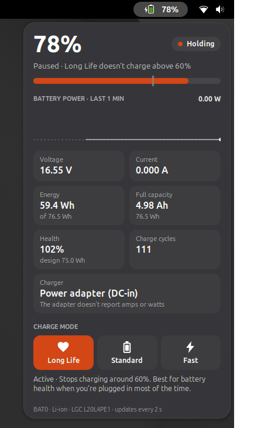

# Battery Charge

A top-bar widget that shows what your laptop battery and charger are doing, and lets you switch the battery's charge mode in one click.



## What it shows

- **Top bar:** battery level, plus the charge or discharge rate when it's above 0.5 W. GNOME's own battery icon is hidden while the widget is on (it comes back if you turn the widget off).
- **Status:** percentage, what the battery is doing (Charging, On battery, Holding, Full) and the time to full or to empty.
- **Level bar,** with a marker at the Long Life stop point.
- **Battery power graph** for the last 10 minutes: green while charging, amber while on battery.
- **Readings:** voltage, current, stored energy (Wh), full capacity (Ah), health against the design capacity, and charge cycles.
- **Charger:** USB-C Power Delivery with the current it reports, or the power adapter. A round-plug (DC-in) adapter has no data connection, so it can't report amps or watts.
- **Charge mode:** Long Life, Standard and Fast. Hover a button to see what it does, then click to switch.

## Charge modes

The modes are the ones your laptop's firmware offers through `/sys/class/power_supply/BAT*/charge_types`. On Lenovo IdeaPads they are:

| Mode | What it does | Lenovo Vantage name |
|---|---|---|
| Long Life | Stops charging around 60%. Best for battery health if the laptop is plugged in most of the time. | Conservation Mode |
| Standard | Charges normally to 100%. | Default |
| Fast | Charges with more current: quicker, but more heat and wear. | Rapid Charge |

The 60% stop point is set by the firmware and can differ between models. To change what the widget shows, edit `LONG_LIFE_LIMIT` at the top of `battery-charge@donkeysbe/extension.js`.

## Requirements

- A laptop whose kernel driver exposes `charge_types` (for example Lenovo IdeaPads with `ideapad_laptop`). Without it, the widget still shows all readings but hides the mode buttons.

## Switching modes without a password

`./install.sh battery` installs a udev rule (`/etc/udev/rules.d/90-battery-charge-mode.rules`) that lets members of the `sudo` group change the charge mode without a password. This step asks for your password once.

Without the rule, the widget asks for your password through polkit each time you switch modes. On distributions where the admin group is `wheel` instead of `sudo`, change the group name in `udev/90-battery-charge-mode.rules` and in `install.sh`.

To remove the rule:

```bash
sudo rm /etc/udev/rules.d/90-battery-charge-mode.rules
```

## How it works

Everything comes from the kernel's power-supply interface in `/sys/class/power_supply`. The widget reads it every 2 seconds while the popup is open and every 5 seconds otherwise. Switching a mode writes the mode name to the battery's `charge_types` file.

To try the widget against recorded data instead of the real hardware, set `BCW_POWER_SUPPLY_DIR` to a folder laid out like `/sys/class/power_supply`.
