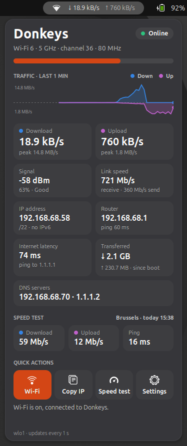

# Network Monitor

A top-bar widget that shows your download and upload speed live, plus everything about the connection you're on.



## What it shows

- **Top bar:** connection icon with the current download (↓) and upload (↑) speed. A VPN icon appears while a VPN is up. GNOME's own network icon is hidden while the widget is on (it comes back if you turn the widget off).
- **Status:** network name, whether you're Online, have No internet, need to sign in (captive portal) or are Connecting, and the Wi-Fi generation, band, channel and channel width.
- **Signal bar** for Wi-Fi strength.
- **Traffic graph** for the last 10 minutes: download in blue above the line, upload in purple below it. Each side has its own scale, so a small upload is still visible next to a big download.
- **Readings:** download and upload speed with their peaks, signal (dBm and quality), link speed, IP address, router with its ping, internet latency, data transferred, and DNS servers.
- **Speed test:** measures your internet download and upload speed and ping. The last result stays in the popup, also after you log out.
- **Quick actions:** turn Wi-Fi on or off, copy your IP address, run a speed test, and open the network settings. Hover a button to see what it does.

## Speed test

Click **Speed test** to measure your internet connection. It takes about 20 seconds: 10 seconds of download, then 10 seconds of upload. Click **Stop** to end it early. It keeps running if you close the popup.

The test uses [Measurement Lab (M-Lab)](https://www.measurementlab.net/), the same open test Google runs when you search for "speed test". The widget picks the nearest M-Lab server and talks to it with M-Lab's ndt7 protocol, so no extra software is needed.

Before you run it, know that:

- **M-Lab publishes every test as open data, including your public IP address.** That's how M-Lab works for all its tests, including Google's. See [M-Lab's privacy policy](https://www.measurementlab.net/privacy/).
- **It uses real data:** each direction runs flat out for 10 seconds, so a fast connection can use a few hundred MB per test. Keep that in mind on a metered connection.
- Results are in megabits per second (Mb/s), like every speed test site, whatever `SPEED_UNITS` is set to.

The last result is saved in `~/.cache/network-monitor/speedtest.json`.

To run the same test from a terminal:

```bash
NMW_SPEEDTEST_CLI=1 gjs -m network-monitor@donkeysbe/speedtest.js
```

## Settings

At the top of `network-monitor@donkeysbe/extension.js`:

| Setting | Default | What it does |
|---|---|---|
| `SPEED_UNITS` | `'bytes'` | `'bytes'` shows kB/s and MB/s. `'bits'` shows kb/s and Mb/s, the way internet providers advertise speeds. Speed test results are always in Mb/s. |
| `LATENCY_HOST` | `'1.1.1.1'` | The address pinged for internet latency. |

Run `./install.sh network` again and log out and back in after changing them.

## Requirements

- NetworkManager (standard on Ubuntu, Fedora and most GNOME desktops).
- Optional: `iw`, for signal in dBm, both link speeds, channel width and Wi-Fi generation. Without it the widget falls back to `/proc/net/wireless` for the signal level and NetworkManager for the rest.

## How it works

- **Speed** comes from the byte counters in `/sys/class/net/*/statistics`, summed over the physical network interfaces (Wi-Fi, Ethernet, USB tethering). Bridges, Docker networks, VPN tunnels and loopback are left out, since their traffic already passes through a physical interface. The widget reads them every second while the popup is open and every 2 seconds otherwise.
- **Connection details** come from NetworkManager through libnm.
- **Speed test:** see [Speed test](#speed-test) above. Nothing is sent to M-Lab unless you click the button.
- **Latency:** while the popup is open, the widget pings the router and `LATENCY_HOST` every 3 seconds. Nothing is pinged while the popup is closed.
- **Transferred** is the total on the active interface since it came up, which is normally since boot.

To try the speed readings against recorded data instead of the real hardware, set `NMW_NET_DIR` to a folder laid out like `/sys/class/net`.
