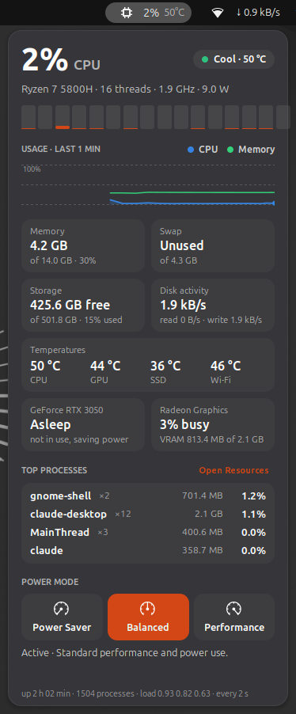

# System Resources

A top-bar widget that shows how hard your computer is working: CPU load and temperature in the bar, and everything else (memory, storage, temperatures, graphics, the busiest programs and the power mode) one click away.



## What it shows

- **Top bar:** CPU load and CPU temperature. You can add memory use (see [Settings](#settings)).
- **Status:** CPU load, a temperature pill (Cool, Warm or Hot), the processor model, thread count, average clock speed and, on AMD laptops, the processor's power draw.
- **Per-thread bars:** one bar per CPU thread, so you can see whether one program is maxing out a single core or the whole chip is busy. Bars above 85% turn amber.
- **Usage graph** for the last 10 minutes: CPU load in blue, memory use in green.
- **Readings:** memory and swap in use, free space on your drives, disk read and write speed, every temperature sensor the system has (CPU, GPU, SSD, Wi-Fi card, plus fans if the laptop reports them), and each GPU's load and memory.
- **Top processes:** the four programs using the most CPU right now, with their memory use. A program with many processes (a browser, say) counts as one, with the number of processes next to its name. The link opens your system monitor app (GNOME System Monitor or Resources).
- **Power mode:** Power Saver, Balanced and Performance, the same setting as in GNOME's quick settings. Hover a button to see what it does, then click to switch. If the system is holding Performance back (for example because the laptop is too hot), the description says so.

## Graphics cards

- **AMD and Intel built-in graphics:** load and video memory come straight from the driver.
- **NVIDIA:** while the card is asleep, the widget just says **Asleep**. It never wakes the card to read it, since an awake NVIDIA card costs a lot of battery. While a program is using it, the widget asks `nvidia-smi` for its load, temperature, power and memory.

## Settings

At the top of `system-resources@donkeysbe/extension.js`:

| Setting | Default | What it does |
|---|---|---|
| `PANEL_SHOW` | `['cpu', 'temp']` | What the top bar shows, in order. Any of `'cpu'`, `'ram'` and `'temp'`. |
| `WARM_AT` | `75` | CPU temperature (°C) where the status turns Warm. |
| `HOT_AT` | `92` | CPU temperature (°C) where it turns Hot. Laptop chips often run at 85–95 °C under load and are usually rated for about 100–105 °C, so Hot is set high to avoid false alarms. |

Run `./install.sh system` again and log out and back in after changing them.

## Requirements

- Linux with `/proc` and `/sys` (any normal desktop install).
- Optional: power-profiles-daemon, for the power mode buttons (installed by default on Ubuntu and Fedora). Without it, that section is hidden.
- Optional: `nvidia-smi` (comes with the NVIDIA driver), for NVIDIA GPU readings.

## How it works

- **CPU, memory, disk activity and processes** come from `/proc` (`stat`, `meminfo`, `diskstats` and each process's `stat` file). Clock speeds come from `/sys/devices/system/cpu`.
- **Temperatures and fans** come from the kernel's hwmon sensors in `/sys/class/hwmon`. The widget recognises the usual drivers (`k10temp` and `coretemp` for the CPU, `amdgpu` for the GPU, `nvme` for SSDs, Wi-Fi drivers) and labels them.
- **Power draw** on AMD laptops is the package power the built-in Radeon graphics driver reports, which covers CPU and graphics together. Intel only exposes this to root, so it isn't shown there.
- **Storage** lists the drives mounted at `/` and other real partitions (not `/boot`, snaps or USB images), up to two.
- **Power mode** talks to power-profiles-daemon over D-Bus, like GNOME's quick settings.
- The widget reads everything every 2 seconds while the popup is open. While it's closed, it only reads what the top bar and graph need, every 3 seconds. Processes, drives and GPUs are read only while the popup is open.

To print what the widget reads on your machine, run:

```bash
SRW_CLI=1 gjs -m system-resources@donkeysbe/sysinfo.js
```
